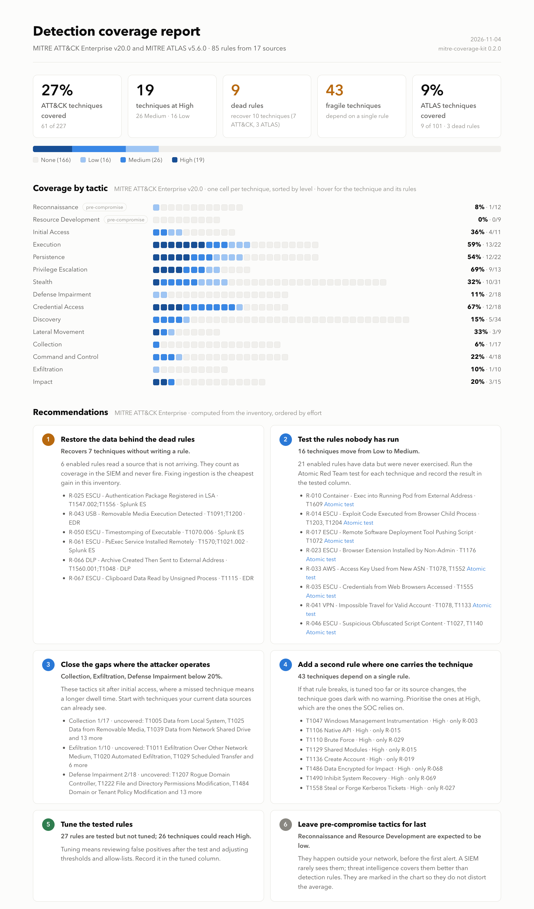
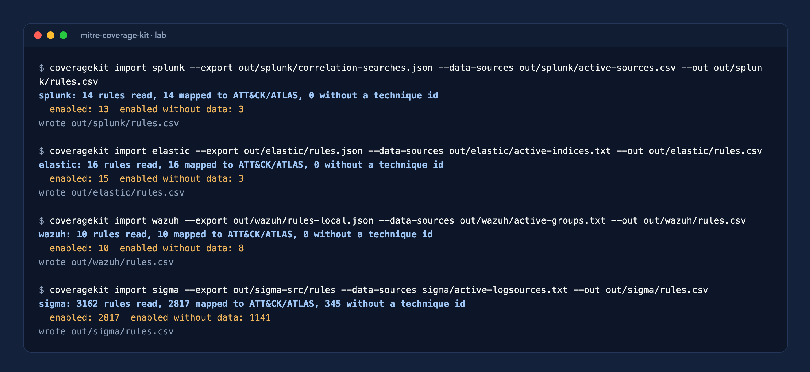
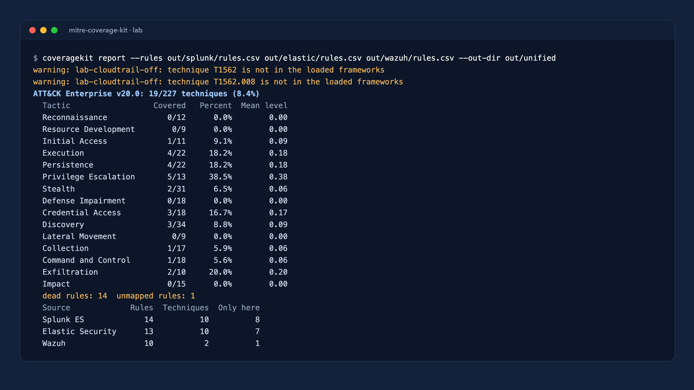
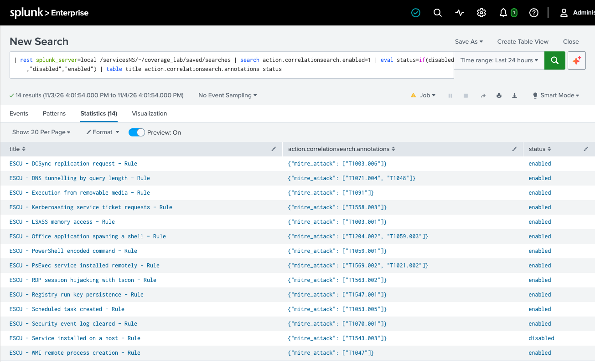
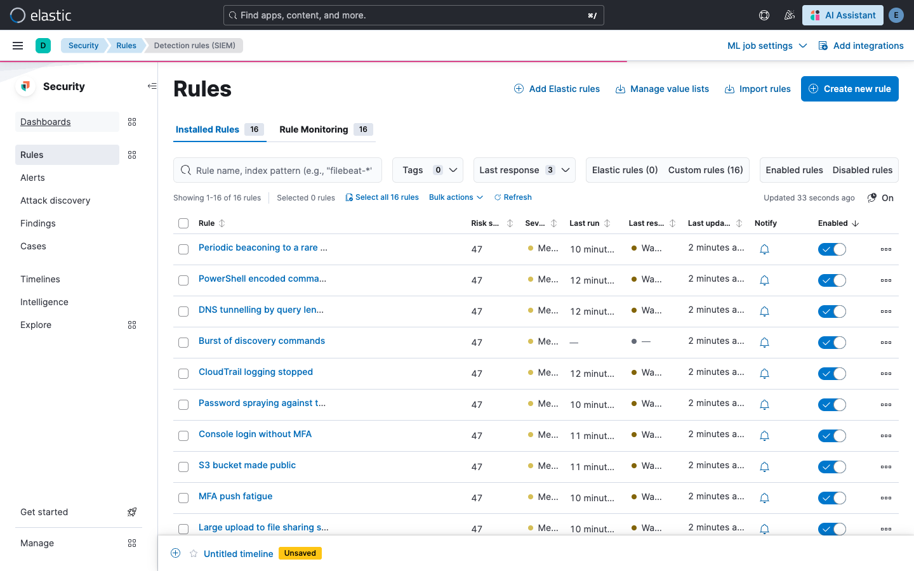
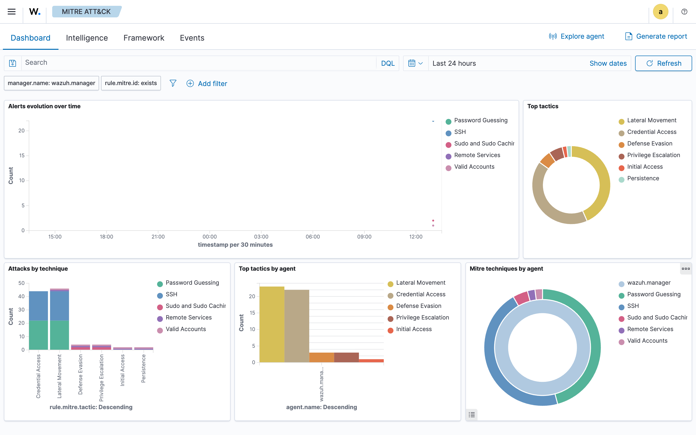
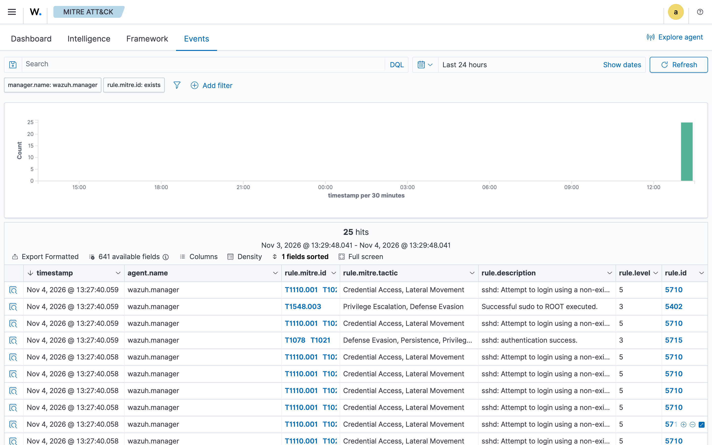

# mitre-coverage-kit

Detection coverage is usually a belief: someone says "we cover credential access" and nobody can say how many techniques, how well, or whether the data behind the rules even arrives. `mitre-coverage-kit` turns that belief into a measurement. It reads the rules of one or several SIEMs (Splunk ES, Elastic Security, Wazuh, Microsoft Sentinel or Sigma), scores every MITRE ATT&CK Enterprise technique and every MITRE ATLAS technique from 0 to 3, exports an ATT&CK Navigator layer you can show the SOC, and renders a heat-map SVG. It also lists dead rules, the ones that are enabled but can never fire because their data source is missing.



## Quick start

Python 3.11 or newer. Install from the repository with `uv` (or `pipx install .`):

```bash
git clone https://github.com/lfjuarez/mitre-coverage-kit.git
cd mitre-coverage-kit
uv venv .venv && uv pip install -e ".[dev]"
```

Then one command per output:

```bash
coveragekit html   --rules examples/rules.csv --out examples/output/report.html
coveragekit score  --rules examples/rules.csv --out examples/output/coverage.json
coveragekit layer  --rules examples/rules.csv --out examples/output/attack-layer.json
coveragekit render --rules examples/rules.csv --framework attack --out examples/output/coverage-attack.svg
```

`coveragekit report --rules examples/rules.csv --out-dir examples/output` produces everything in one go, including the ATLAS heat map. The package bundles ATT&CK Enterprise v20.0 and ATLAS v5.6.0; run `coveragekit fetch --dest DIR` to download newer releases and pass `--frameworks-dir DIR` to the other commands to use them.

## Input format

A CSV (or a JSON list of objects with the same keys) with one row per detection rule:

```csv
rule_id,name,techniques,enabled,data_available,tested,tuned,owner,source
R-001,ESCU - Suspicious PowerShell Encoded Command,T1059.001,true,true,true,true,detection-eng,Splunk ES
R-004,ESCU - Python Script Execution from Temp Directory,T1059.006,true,true,true,false,detection-eng,Splunk ES
R-008,ESCU - Rundll32 Loading DLL from User Profile,T1218.011,true,true,false,false,detection-eng,Splunk ES
R-080,LLM - sensitive data leaked in completion,AML.T0057,true,false,false,false,ai-secops,DLP
```

`techniques` is a semicolon-separated list of ATT&CK or ATLAS ids; sub-technique ids such as `T1059.001` or `AML.T0051.000` are accepted. Booleans accept `true/false`, `yes/no` and `1/0`. Rule ids must be unique and every rule needs at least one well-formed technique id. Ids that are well-formed but absent from the loaded matrices are reported as warnings, not errors. The required columns are `rule_id`, `techniques`, `enabled` and `data_available`; the rest are optional. `data_sources` lists what the rule reads, as `kind:value` separated by semicolons (for example `index:wineventlog;sourcetype:XmlWinEventLog:Security`); the importers fill it in. `missing_data` is the subset the import could not find in `--data-sources`; the report groups the dead rules by it, so one missing sourcetype that silences four rules shows up as one line.

## Import from your SIEM

You do not have to build the CSV by hand. `coveragekit import` reads the native export of each SIEM, takes the ATT&CK and ATLAS ids the rules already carry, and writes the inventory:

```bash
coveragekit import splunk   --export correlation-searches.json --data-sources active-sources.csv --out splunk.csv
coveragekit import elastic  --export rules.ndjson              --data-sources active-indices.txt --out elastic.csv
coveragekit import wazuh    --export rules.json                --data-sources active-groups.txt  --out wazuh.csv
coveragekit import sigma    --export sigma/rules/              --data-sources logsources.txt     --out sigma.csv
coveragekit import sentinel --export analytics-rules.json      --data-sources tables.txt         --out sentinel.csv
```

| SIEM | Export (`--export`) | Techniques from | Data sources a rule needs | Active sources (`--data-sources`) |
|---|---|---|---|---|
| Splunk ES | REST `GET /servicesNS/-/-/saved/searches?output_mode=json&count=0`, or a CSV from `\| rest` | `action.correlationsearch.annotations` (`mitre_attack`, `mitre_atlas`) | `index`, `sourcetype` and `datamodel` in the SPL (all of them) | `\| tstats count where index=* by index sourcetype` with `earliest_time=-7d`, exported as CSV |
| Elastic Security | `GET /api/detection_engine/rules/_find?per_page=10000`, or the `_export` NDJSON | `threat[]` (MITRE ATT&CK and MITRE ATLAS, sub-techniques included) | `index` patterns, or `FROM` in ES\|QL rules (any of them) | `terms` aggregation on `_index` over `logs-*` for the last 7 days; backing indices count as their data stream |
| Wazuh | API `GET /rules?limit=100000`, or rule XML files / a directory | `<mitre><id>` | rule groups (any of them); level 0 rules count as disabled | rule groups seen in `alerts.json` (or `wazuh-alerts-*`) in the last 7 days |
| Sigma | a rule file or a directory | `attack.tNNNN` tags (`atlas.aml.tNNNN` also accepted) | `logsource` as `product/category` or `product/service` | the log sources you collect, for example `windows/process_creation` |
| Microsoft Sentinel | ARM template export or REST `alertRules` JSON | `techniques` and `subTechniques` | tables read by the KQL query (all of them) | `union withsource=T * \| where TimeGenerated > ago(7d) \| distinct T` |

`--data-sources` takes a CSV whose header uses `index`, `sourcetype`, `datamodel`, `table`, `group` or `logsource`, or plain text with one source per line, optionally prefixed with its kind (`datamodel:Endpoint`). Wildcards work in both directions. Without `--data-sources` every rule is assumed to have data and the command warns about it; that is the column that finds dead rules, so it is worth the extra query. Rules with no technique id are counted and left out. SIEMs do not record whether a rule was tested against an emulated attack or tuned, so those columns start as `false`: fill them in, and pass `--keep-from previous.csv` on the next import to keep them.

## Several SIEMs, one coverage

Pass one inventory per SIEM and they are merged:

```bash
coveragekit report --rules splunk.csv elastic.csv wazuh.csv --out-dir out/
```

Each technique takes the best level across all SIEMs, so the matrix shows what the organisation detects as a whole. The summary adds one row per SIEM with its rules, the techniques it covers and how many techniques only that SIEM covers, which is the number to look at before decommissioning one. `coverage.json` carries the same table under `sources`. Rule ids that repeat across files are qualified with their source.

## Integration lab

`lab/` runs the importers against real SIEMs in containers, one at a time: Splunk Enterprise with 14 correlation searches, Elastic Security with 16 detection rules (three of them mapped to ATLAS) and a Wazuh manager with 10 custom rules on top of its default ruleset. The detections come from one catalog (`lab/catalog.py`) with different TTPs per SIEM and some overlap, and some of the data sources they need are never loaded, so dead rules appear on purpose. On Apple Silicon, Splunk runs under Rosetta; the lab app disables the KV store, which needs CPU instructions Rosetta does not emulate. `lab/wazuh/run-full.sh` brings up the full Wazuh stack (indexer, manager and dashboard) from the official wazuh-docker repository for the screenshots. Each `lab/<siem>/run.sh` starts the container, loads rules and sample events, and writes the export and the active sources to `lab/out/<siem>/`. The importers were also run against the full Wazuh default ruleset (4,499 rules) and the public SigmaHQ repository (3,162 rules).













The run also surfaced a real migration issue: ATT&CK v20 retired T1562 (Impair Defenses), so rules still tagged `T1562.*` are reported as unmapped until they are remapped to the new Defense Impairment techniques.

## The report

`report.html` is a single file with no external assets, so it can be mailed, dropped into a ticket or printed to PDF from the browser. It shows the key figures, a row of cells per tactic (hover gives the technique, its level and its rules), coverage by source when the inventory comes from several SIEMs, the dead rules, and a searchable table of every technique. The same page carries the recommendations, which are computed from the inventory with plain rules and ordered by effort:

1. **Restore the data behind the dead rules**: how many techniques come back without writing a rule, and which missing sources silence them (from the `missing_data` column the importers fill in).
2. **Test the rules nobody has run**: enabled rules with data that were never exercised, with a link to the Atomic Red Team test for each technique.
3. **Close the gaps where the attacker operates**: the post-access tactics under 20 % and their uncovered techniques.
4. **Add a second rule where one carries the technique**: techniques that depend on a single rule, highest level first.
5. **Tune the tested rules**: how many techniques would reach High.
6. **Remap rules that point at retired techniques**, when the inventory references ids that are not in the loaded matrix.
7. **Leave pre-compromise tactics for last**: Reconnaissance and Resource Development are marked so they do not distort the average.

The numbers behind the recommendations are also in `coverage.json` under `analysis` (`fragile`, `recoverable`, `dead_by_source`, `untested_rules`, `untuned_rules`, `weak_tactics` and the `recommendations` themselves), so another tool can read them without the HTML.

## How scoring works

Each rule gets a quality level:

| Level | Name   | Condition                                   |
|-------|--------|---------------------------------------------|
| 0     | None   | not enabled, or no data available           |
| 1     | Low    | enabled and data available                  |
| 2     | Medium | Low, and tested                             |
| 3     | High   | Low, and tested and tuned                   |

A technique takes the maximum quality over all rules that reference it. Sub-technique ids roll up to their parent technique, because the matrices show parents only, so a `T1059.001` rule counts toward `T1059`. A tactic's coverage is the share of its techniques with level 1 or higher, and the report also gives the mean level. A technique that belongs to several tactics is scored once and shown under each of them.

Dead rules are enabled rules whose `data_available` is false. They look like coverage in the SIEM but can never fire, so they are listed separately and never counted. Rules whose ids do not exist in the matrix are listed as unmapped.

## Outputs

`coverage.json` contains, per framework (`attack` and `atlas`):

- `totals`: tactics, cells, distinct techniques, distinct covered, percent and the count at each level.
- `tactics`: per tactic, the technique count, covered count, percent and mean level.
- `cells`: one entry per tactic and technique with `framework`, `tactic`, `tactic_id`, `id`, `name`, `level` and the `rules` that reference it.
- `dead_rules` and `unmapped_rules`.
- `analysis`: the statistics and recommendations described above.
- `sources`: with more than one SIEM, rules, techniques covered and techniques covered only there, per SIEM.

`attack-layer.json` is an ATT&CK Navigator layer (layer format 4.5, Enterprise domain) with scores 0, 33, 66 and 100 and a comment per technique that lists the contributing rules. To use it, open the [ATT&CK Navigator](https://mitre-attack.github.io/attack-navigator/), choose Open Existing Layer, then Upload from local, and select the file.

`report.html` is the HTML report described above.

`coverage-attack.svg` and `coverage-atlas.svg` are self-contained SVGs: a fingerprint matrix with one column per tactic and one cell per technique, horizontal bars with the percentage of techniques covered per tactic, a legend and a footer with totals.

## ATLAS

MITRE ATLAS covers adversarial threats to AI systems, for example LLM prompt injection (`AML.T0051`), jailbreaks (`AML.T0054`) and exfiltration through an inference API (`AML.T0024`). Rules that reference ATLAS ids are scored the same way and appear in `coverage.json` and `coverage-atlas.svg`. ATLAS has its own Navigator tooling, so the layer export covers ATT&CK Enterprise only.

## Limitations

Coverage of a technique is not detection quality against every procedure. A technique marked High means you have a tested and tuned rule for at least one way of performing it, not that every variant is caught. Use the numbers to find gaps and dead rules, then confirm with adversary emulation or purple-team testing. The scores depend entirely on how honestly the `tested` and `tuned` columns are maintained.

## Development

```bash
uv venv .venv && uv pip install -e ".[dev]"
.venv/bin/ruff check src tests
.venv/bin/pytest -q
```

## Author

Leandro F. Juárez, [LinkedIn](https://www.linkedin.com/in/leandrofjuarez). Built for client engagements; the sample data in `examples/` is synthetic. Released under the MIT license.
