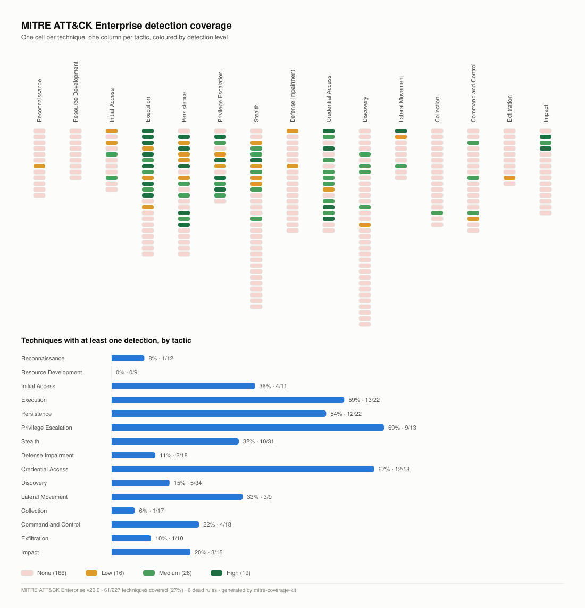

# mitre-coverage-kit

Detection coverage is usually a belief: someone says "we cover credential access" and nobody can say how many techniques, how well, or whether the data behind the rules even arrives. `mitre-coverage-kit` turns that belief into a measurement. It reads your SIEM rule inventory, scores every MITRE ATT&CK Enterprise technique and every MITRE ATLAS technique from 0 to 3, exports an ATT&CK Navigator layer you can show the SOC, and renders a heat-map SVG. It also lists dead rules, the ones that are enabled but can never fire because their data source is missing.



## Quick start

Python 3.11 or newer. Install from the repository with `uv` (or `pipx install .`):

```bash
git clone https://github.com/lfjuarez/mitre-coverage-kit.git
cd mitre-coverage-kit
uv venv .venv && uv pip install -e ".[dev]"
```

Then three commands:

```bash
coveragekit score  --rules examples/rules.csv --out examples/output/coverage.json
coveragekit layer  --rules examples/rules.csv --out examples/output/attack-layer.json
coveragekit render --rules examples/rules.csv --framework attack --out examples/output/coverage-attack.svg
```

`coveragekit report --rules examples/rules.csv --out-dir examples/output` produces everything in one go, including the ATLAS heat map. The package bundles ATT&CK Enterprise v20.0 and ATLAS v5.6.0; run `coveragekit fetch --dest DIR` to download newer releases and pass `--frameworks-dir DIR` to the other commands to use them.

## Input format

A CSV (or a JSON list of objects with the same keys) with one row per detection rule:

```csv
rule_id,name,techniques,enabled,data_available,tested,tuned,owner,source
R-001,ESCU - Suspicious PowerShell Encoded Command,T1059.001,true,true,true,true,detection-eng,Splunk ES
R-004,ESCU - Python Script Execution from Temp Directory,T1059.006,true,true,true,false,detection-eng,Splunk ES
R-008,ESCU - Rundll32 Loading DLL from User Profile,T1218.011,true,true,false,false,detection-eng,Splunk ES
R-080,LLM - sensitive data leaked in completion,AML.T0057,true,false,false,false,ai-secops,DLP
```

`techniques` is a semicolon-separated list of ATT&CK or ATLAS ids; sub-technique ids such as `T1059.001` or `AML.T0051.000` are accepted. Booleans accept `true/false`, `yes/no` and `1/0`. Rule ids must be unique and every rule needs at least one well-formed technique id. Ids that are well-formed but absent from the loaded matrices are reported as warnings, not errors. The required columns are `rule_id`, `techniques`, `enabled` and `data_available`; the rest are optional.

## How scoring works

Each rule gets a quality level:

| Level | Name   | Condition                                   |
|-------|--------|---------------------------------------------|
| 0     | None   | not enabled, or no data available           |
| 1     | Low    | enabled and data available                  |
| 2     | Medium | Low, and tested                             |
| 3     | High   | Low, and tested and tuned                   |

A technique takes the maximum quality over all rules that reference it. Sub-technique ids roll up to their parent technique, because the matrices show parents only, so a `T1059.001` rule counts toward `T1059`. A tactic's coverage is the share of its techniques with level 1 or higher, and the report also gives the mean level. A technique that belongs to several tactics is scored once and shown under each of them.

Dead rules are enabled rules whose `data_available` is false. They look like coverage in the SIEM but can never fire, so they are listed separately and never counted. Rules whose ids do not exist in the matrix are listed as unmapped.

## Outputs

`coverage.json` contains, per framework (`attack` and `atlas`):

- `totals`: tactics, cells, distinct techniques, distinct covered, percent and the count at each level.
- `tactics`: per tactic, the technique count, covered count, percent and mean level.
- `cells`: one entry per tactic and technique with `framework`, `tactic`, `tactic_id`, `id`, `name`, `level` and the `rules` that reference it.
- `dead_rules` and `unmapped_rules`.

`attack-layer.json` is an ATT&CK Navigator layer (layer format 4.5, Enterprise domain) with scores 0, 33, 66 and 100 and a comment per technique that lists the contributing rules. To use it, open the [ATT&CK Navigator](https://mitre-attack.github.io/attack-navigator/), choose Open Existing Layer, then Upload from local, and select the file.

`coverage-attack.svg` and `coverage-atlas.svg` are self-contained SVGs: a fingerprint matrix with one column per tactic and one cell per technique, horizontal bars with the percentage of techniques covered per tactic, a legend and a footer with totals.

## ATLAS

MITRE ATLAS covers adversarial threats to AI systems, for example LLM prompt injection (`AML.T0051`), jailbreaks (`AML.T0054`) and exfiltration through an inference API (`AML.T0024`). Rules that reference ATLAS ids are scored the same way and appear in `coverage.json` and `coverage-atlas.svg`. ATLAS has its own Navigator tooling, so the layer export covers ATT&CK Enterprise only.

## Limitations

Coverage of a technique is not detection quality against every procedure. A technique marked High means you have a tested and tuned rule for at least one way of performing it, not that every variant is caught. Use the numbers to find gaps and dead rules, then confirm with adversary emulation or purple-team testing. The scores depend entirely on how honestly the `tested` and `tuned` columns are maintained.

## Development

```bash
uv venv .venv && uv pip install -e ".[dev]"
.venv/bin/ruff check src tests
.venv/bin/pytest -q
```

## Author

Leandro F. Juárez, [LinkedIn](https://www.linkedin.com/in/leandrofjuarez). Built for client engagements; the sample data in `examples/` is synthetic. Released under the MIT license.
