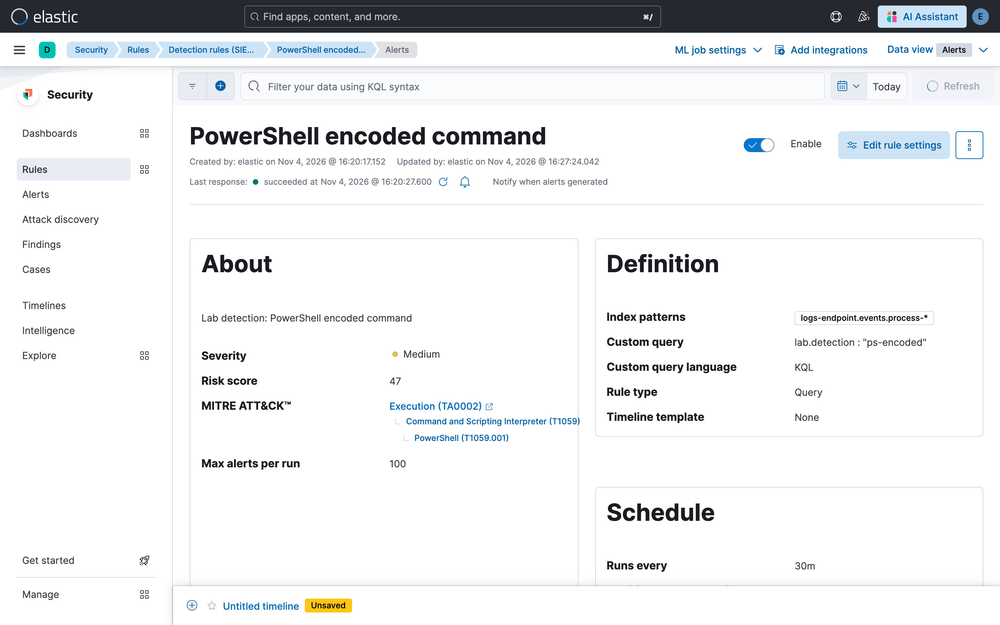
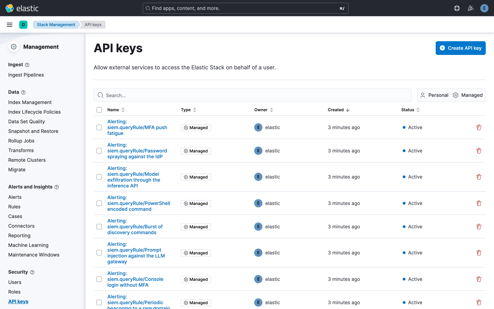
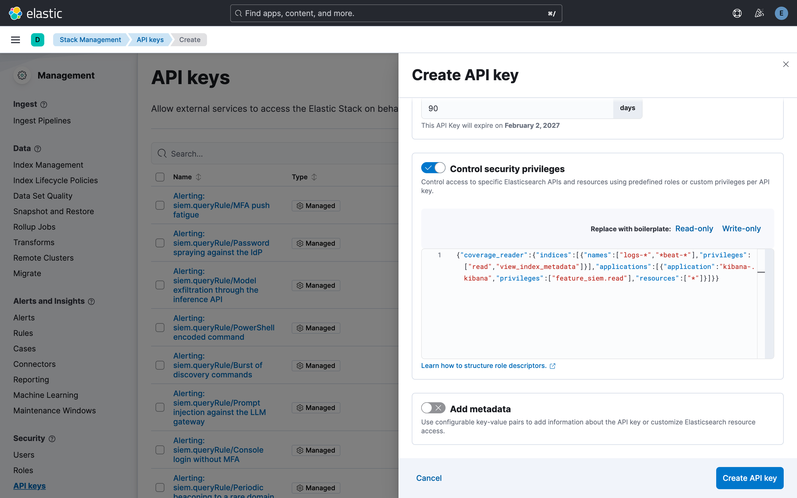
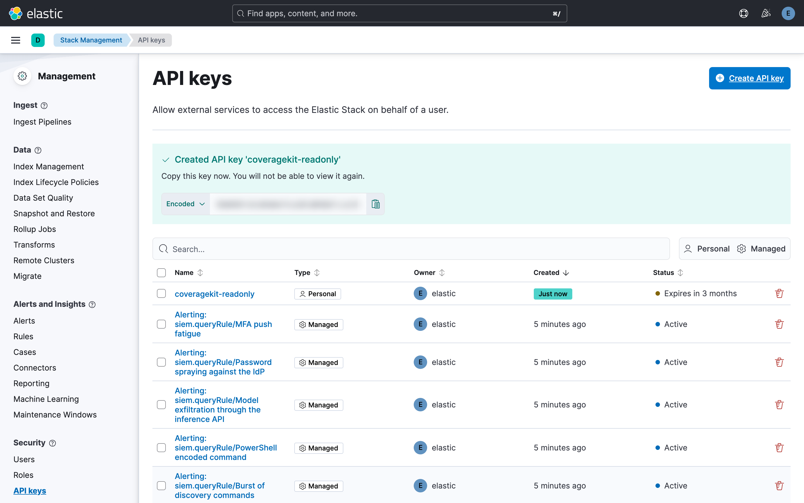
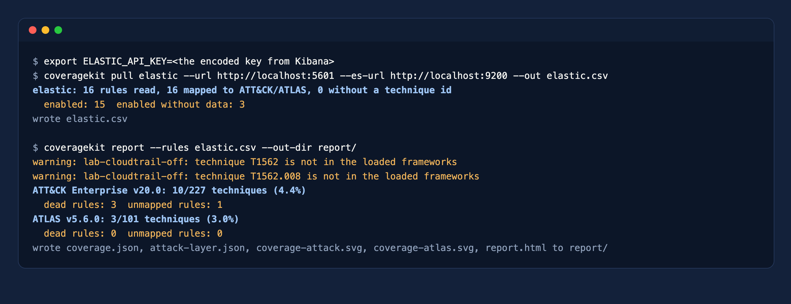

# Elastic Security

Five minutes. You create an API key that can only read detection rules and the log indices, and `coveragekit` reads the rules with their MITRE mapping straight from Kibana.

## What the tool reads

Each detection rule in Elastic Security already carries its ATT&CK (or ATLAS) techniques. `coveragekit` reads that mapping and the index patterns the rule queries, then asks Elasticsearch which indices received events in the last seven days. A rule whose indices are empty counts as a dead rule.



## Step 1. Open API keys

In Kibana, go to **Stack Management > Security > API keys** and click **Create API key**. You need a user that can manage API keys; the key itself will have far fewer privileges than that user.



## Step 2. Create a restricted key

1. **Name:** `coveragekit-readonly`.
2. **Apply expiration date:** on, for example 90 days.
3. **Control security privileges:** on, and replace the editor content with:

```json
{
  "coverage_reader": {
    "indices": [
      { "names": ["logs-*", "*beat-*"], "privileges": ["read", "view_index_metadata"] }
    ],
    "applications": [
      { "application": "kibana-.kibana", "privileges": ["feature_siem.read"], "resources": ["*"] }
    ]
  }
}
```

Adjust `names` to the index patterns your rules use. `feature_siem.read` lets the key read detection rules and nothing else in Kibana.



## Step 3. Copy the key

Click **Create API key** and copy the **Encoded** value. Kibana shows it only once.



## Step 4. Run the tool

```bash
export ELASTIC_API_KEY='<the encoded key>'
coveragekit pull elastic --url https://kibana.example.com --es-url https://es.example.com:9200 --out elastic.csv
coveragekit report --rules elastic.csv --out-dir report/
```



`--es-url` is what finds dead rules. Without it every rule is assumed to have data and the tool warns about it. The warning about `T1562` in the screenshot is real: ATT&CK v20 retired that technique, and the report lists the rule under "Remap rules that point at retired techniques".

## Check that the key cannot write

In the lab, the same key gets `403` when it tries to create a rule or index a document:

```bash
curl -s -o /dev/null -w '%{http_code}\n' -X POST -H "Authorization: ApiKey $ELASTIC_API_KEY" \
  -H 'kbn-xsrf: true' -H 'Content-Type: application/json' \
  https://kibana.example.com/api/detection_engine/rules -d '{"rule_id":"x","name":"x","description":"x","type":"query","query":"*","index":["logs-*"],"risk_score":1,"severity":"low"}'
# 403
```

## Without network access

Export the rules from **Security > Rules > Detection rules > Export** (NDJSON), list the active indices with the search below, and run `coveragekit import elastic --export rules.ndjson --data-sources active-indices.txt --out elastic.csv`.

```json
GET logs-*,*beat-*/_search?size=0
{ "query": { "range": { "@timestamp": { "gte": "now-7d" } } },
  "aggs": { "i": { "terms": { "field": "_index", "size": 5000 } } } }
```
