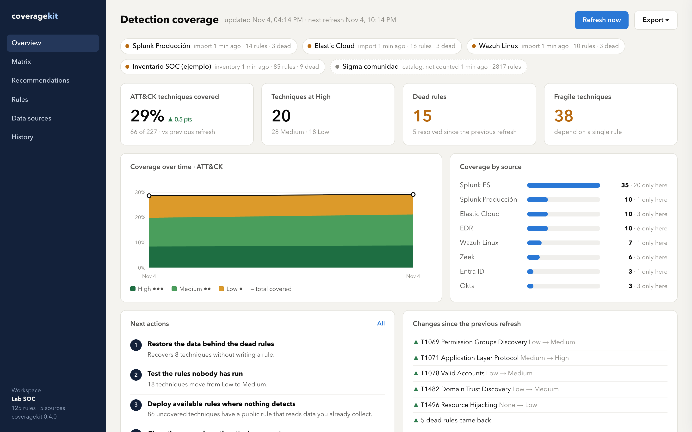
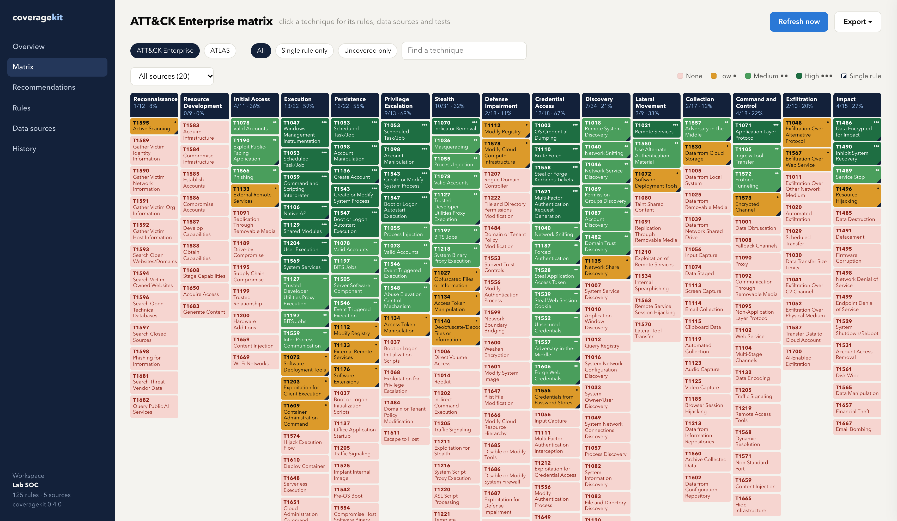

# Several SIEMs and the web app

Once each SIEM has its read-only credential, `coveragekit serve` keeps them all in one place: it pulls every source on a schedule, scores them together and shows the result in a browser.

## Step 1. Give each source its own prefix

Each source reads its credentials from environment variables with its own prefix, so two Splunks never share a token:

```bash
export SPLUNK_PROD_TOKEN='...'
export SPLUNK_DR_TOKEN='...'
export ELASTIC_CLOUD_API_KEY='...'
export WAZUH_LINUX_USER=coverage-ro WAZUH_LINUX_PASSWORD='...'
```

## Step 2. Write the config

```toml
[server]
title = "Example SOC"
data_dir = "coveragekit-data"
refresh_hours = 6

[[source]]
name = "Splunk Producción"
type = "splunk"
url = "https://splunk-prod.example.com:8089"
env_prefix = "SPLUNK_PROD"
ca = "certs/splunk-ca.pem"

[[source]]
name = "Splunk DR"
type = "splunk"
url = "https://splunk-dr.example.com:8089"
env_prefix = "SPLUNK_DR"

[[source]]
name = "Elastic Cloud"
type = "elastic"
url = "https://kibana.example.com"
es_url = "https://es.example.com:9200"
env_prefix = "ELASTIC_CLOUD"

[[source]]
name = "Wazuh Linux"
type = "wazuh"
url = "https://wazuh.example.com:55000"
indexer_url = "https://wazuh.example.com:9200"
env_prefix = "WAZUH_LINUX"

[[source]]
name = "Sigma"
type = "catalog"            # suggestions for gaps, never counted as coverage
siem = "sigma"
export = "sigma/rules"
data_sources = "logsources.txt"
```

The config refuses keys such as `token` or `password`: credentials only live in the environment.

## Step 3. Start it

```bash
coveragekit serve --config coveragekit.toml
```

Open http://127.0.0.1:8700. The strip at the top shows each source and when it was pulled; a source that fails keeps its last good inventory and shows the error.





## Step 4. Mark what you tested

SIEMs do not record whether a rule was tested against an emulated attack or tuned. Edit the `tested`, `tuned` and `owner` columns in `coveragekit-data/inventories/<source>.csv`; the next pull keeps them. That is what moves techniques from Low to Medium and High.

## Step 5. Share

**Export** in the top bar downloads the PDF report, the Excel workbook, CSVs, a Markdown summary or the Navigator layer. History compares any two refreshes.

## Exposing it to a team

The server listens on `127.0.0.1` and has no login of its own. To share it, put it behind a reverse proxy that handles sign-in (for example your SSO), and set `host` in `[server]` to the name the proxy uses so the Host check accepts it.
