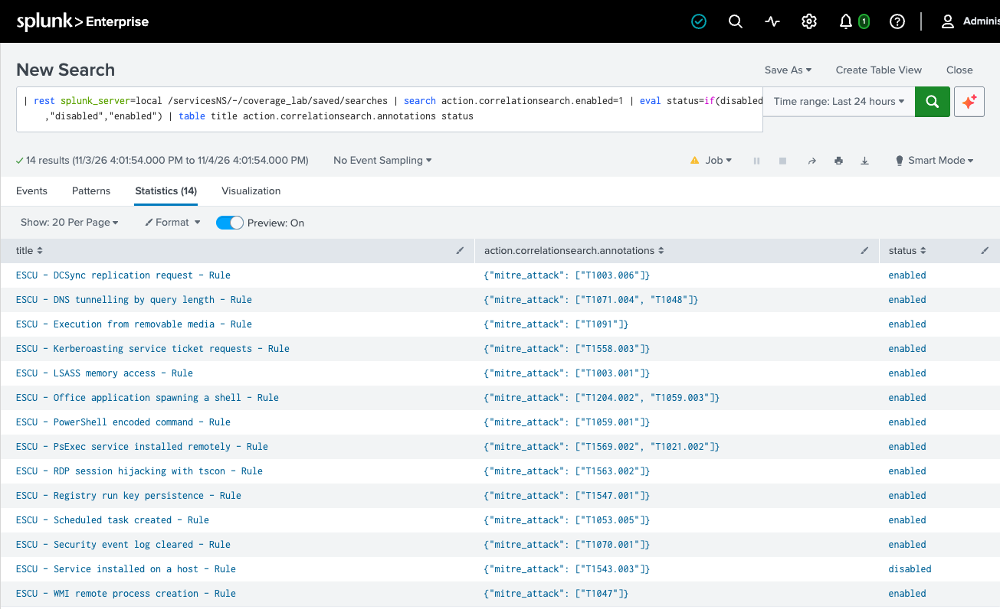
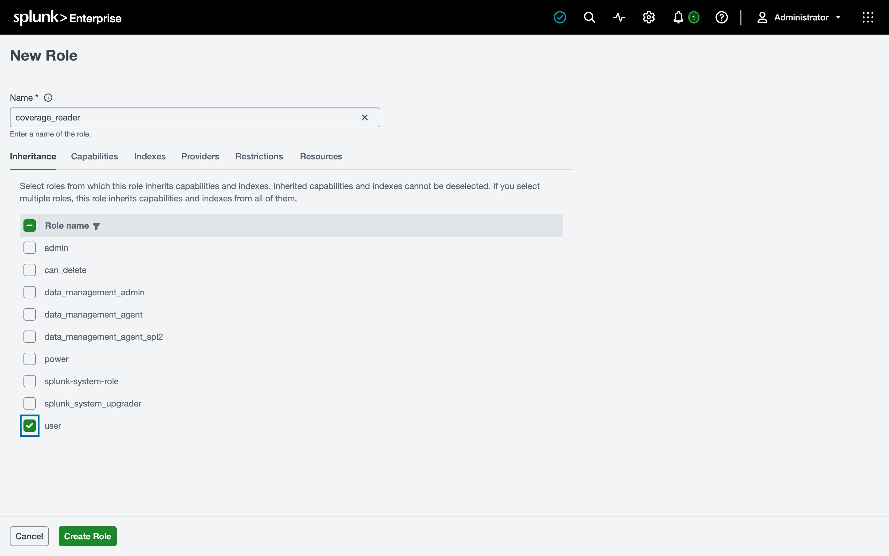
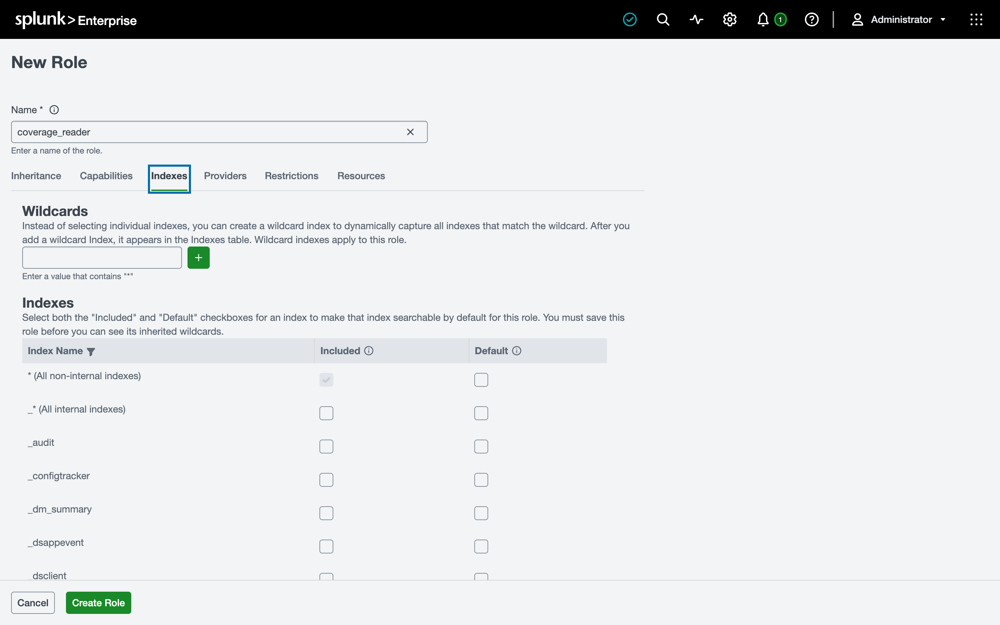
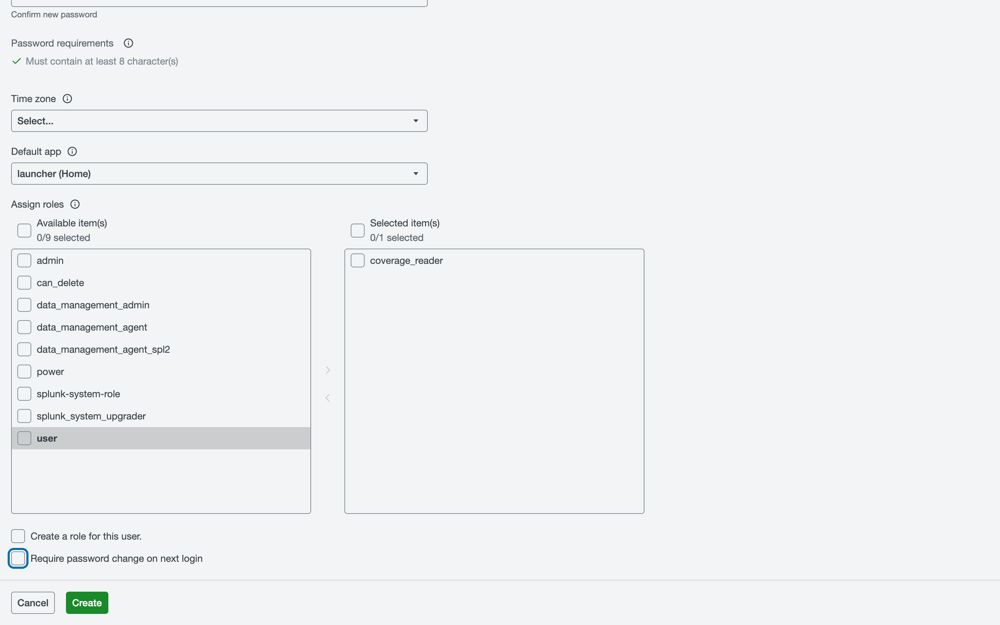
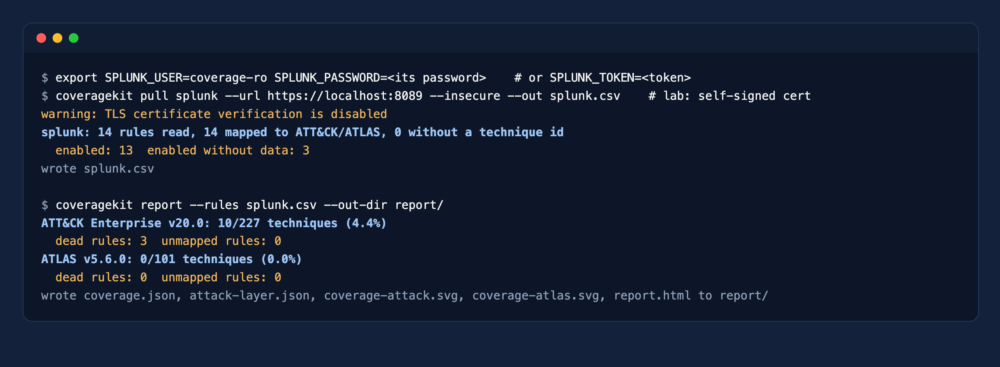

# Splunk Enterprise Security

Ten minutes. You create a role that can search, a user with only that role, and `coveragekit` reads the correlation searches with their MITRE annotations plus the sourcetypes that received events in the last seven days.

## What the tool reads

Splunk ES stores the ATT&CK techniques of each correlation search in its annotations. `coveragekit` reads them over the REST API, parses the `index`, `sourcetype` and `datamodel` each search uses, and runs one `tstats` search to see which of those sources had events recently.



## Step 1. Create a role

Go to **Settings > Roles > New Role**.

1. **Name:** `coverage_reader`.
2. **Inheritance:** tick `user`. That gives the role the `search` and `rest_properties_get` capabilities and nothing administrative.



3. **Indexes:** inheriting `user` already searches all non-internal indexes (`*`). Keep it that way, or restrict it to the indexes your correlation searches read.



Click **Create Role**.

## Step 2. Create the user

Go to **Settings > Users > New User**.

1. **Name:** `coverage-ro`, with a long random password.
2. **Assign roles:** `coverage_reader` only. Remove `user` from the selected list.
3. **Require password change on next login:** off. This is a service account.



## Step 3 (optional). Create a token

A token is better than a password: it expires and can be revoked alone. Go to **Settings > Tokens**, enable token authentication if needed, and create a token for `coverage-ro` with an expiry. Tokens need the KV store; on deployments where it is off, use the user and password.

## Step 4. Run the tool

```bash
export SPLUNK_TOKEN='<token>'                          # or SPLUNK_USER and SPLUNK_PASSWORD
coveragekit pull splunk --url https://splunk.example.com:8089 --ca splunk-ca.pem --out splunk.csv
coveragekit report --rules splunk.csv --out-dir report/
```

The URL is the management port (8089), not Splunk Web. The lab uses a self-signed certificate, so the screenshot shows `--insecure`; in production pass your CA with `--ca`.



## About the role

Splunk has no strictly read-only built-in role: `user` can still save private searches. `coveragekit` itself only issues GET requests and one `tstats` search, and it never saves anything. If your policy requires it, restrict the role further with **Restrictions** and **Resources** (search concurrency, time window).

## Without network access

Export the correlation searches and the active sources by hand, then run `coveragekit import splunk`:

```bash
curl -k -H "Authorization: Bearer $SPLUNK_TOKEN" \
  "https://splunk.example.com:8089/servicesNS/-/-/saved/searches?output_mode=json&count=0&search=action.correlationsearch.enabled%3D1" \
  -o correlation-searches.json
curl -k -H "Authorization: Bearer $SPLUNK_TOKEN" https://splunk.example.com:8089/services/search/jobs/export \
  --data-urlencode 'search=| tstats count where index=* by index sourcetype' -d earliest_time=-7d -d output_mode=csv \
  -o active-sources.csv
coveragekit import splunk --export correlation-searches.json --data-sources active-sources.csv --out splunk.csv
```
