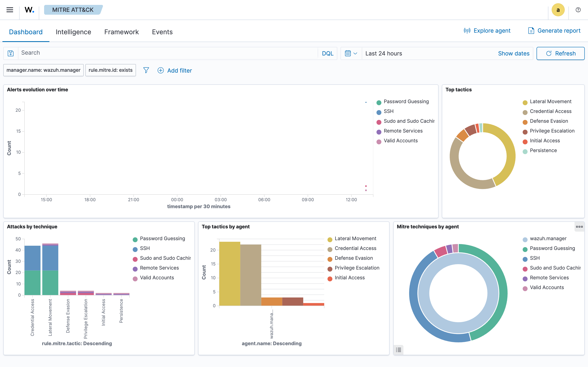
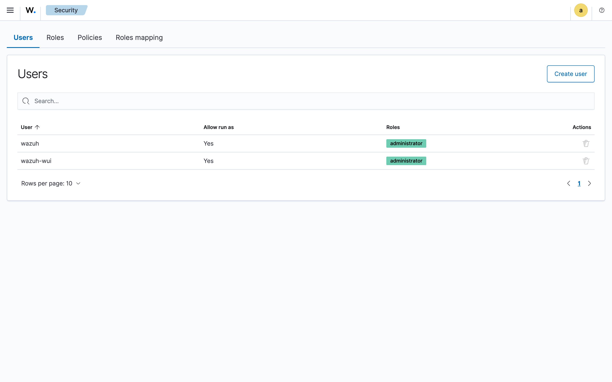
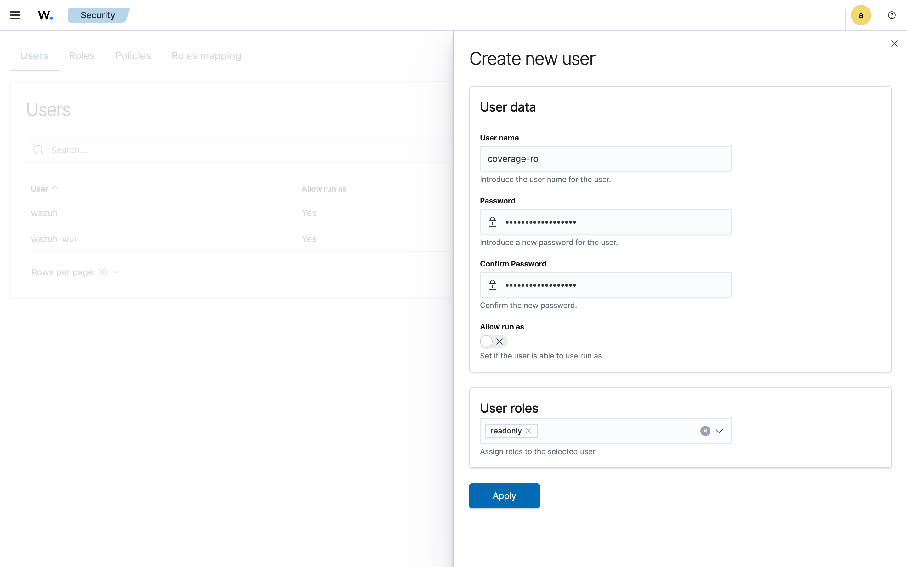
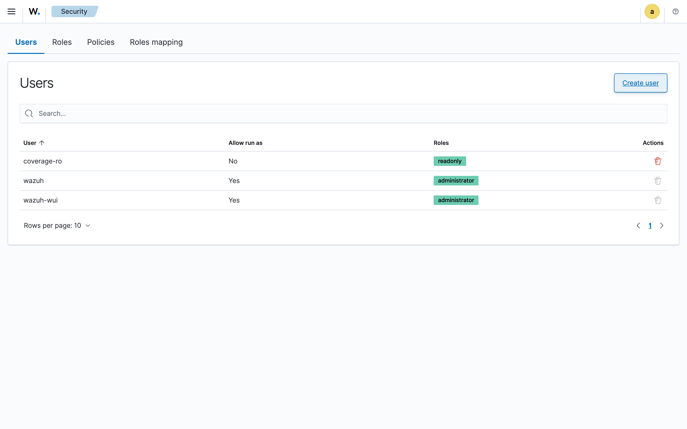
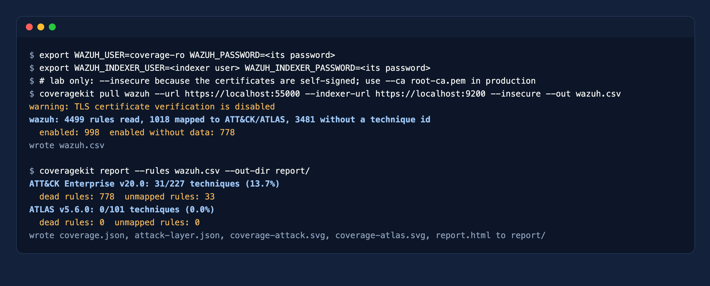

# Wazuh

Five minutes. You create a server API user with the built-in `readonly` role, and `coveragekit` reads every rule with its MITRE mapping, plus the rule groups seen in alerts in the last seven days.

## What the tool reads

Wazuh rules carry their ATT&CK techniques in `<mitre>`. `coveragekit` reads all rules through the server API (paginated, about 4,500 in a default install), and asks the indexer which rule groups produced alerts recently. A rule whose groups never alert counts as a dead rule.



## Step 1. Open Security

In the Wazuh dashboard, open the menu and go to **Server management > Security**, tab **Users**, then click **Create user**.



## Step 2. Create the user

1. **User name:** `coverage-ro`, with a long random password.
2. **Allow run as:** off.
3. **User roles:** pick `readonly` from the list (not `agents_readonly` or `cluster_readonly`).



Click **Apply**. The server API has no API keys: the tool logs in with this user at every run and gets a token that expires in minutes.



## Step 3. Access to the indexer

To find dead rules the tool also needs to read `wazuh-alerts-*` in the indexer. Use an indexer user whose role only has `read` on `wazuh-alerts-*` (in the indexer security plugin: a role with that index permission, mapped to the user). Without it, pass no `--indexer-url` and every rule is assumed to have data.

## Step 4. Run the tool

```bash
export WAZUH_USER=coverage-ro WAZUH_PASSWORD='<password>'
export WAZUH_INDEXER_USER=<indexer user> WAZUH_INDEXER_PASSWORD='<password>'
coveragekit pull wazuh --url https://wazuh.example.com:55000 --indexer-url https://wazuh.example.com:9200 \
  --ca root-ca.pem --out wazuh.csv
coveragekit report --rules wazuh.csv --out-dir report/
```



The numbers in the screenshot are the default ruleset plus ten lab rules, with only sshd and sudo logs arriving: most rules read sources the lab does not send, so they show as dead. On a real manager with agents the picture is very different. `unmapped rules` are rules tagged with technique ids that ATT&CK v20 no longer has.

## Without network access

```bash
curl -k -u coverage-ro:<password> -X POST "https://wazuh.example.com:55000/security/user/authenticate?raw=true"   # prints a token
curl -k -H "Authorization: Bearer <token>" "https://wazuh.example.com:55000/rules?limit=100000" -o rules.json
coveragekit import wazuh --export rules.json --data-sources active-groups.txt --out wazuh.csv
```

`active-groups.txt` has one `group:<name>` per line, from a terms aggregation on `rule.groups` over `wazuh-alerts-*`. The rule XML files work too: `coveragekit import wazuh --export /var/ossec/etc/rules/`.
